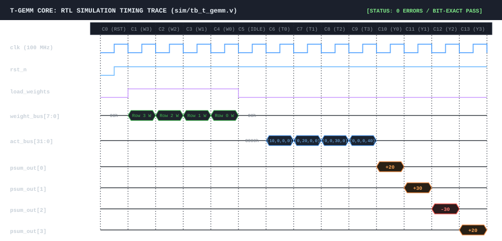

# T-GEMM Core

[](https://github.com/smtherer/t-gemm-core/actions/workflows/ci.yml)


A multiplierless 1.58-bit ternary systolic inference accelerator designed in synthesizable Verilog for sub-watt edge intelligence.

---

## 1. Architectural Overview

T-GEMM Core is an open-source, cycle-accurate 2D systolic inference engine targeting quantized ternary neural networks ($W \in \{-1, 0, +1\}$, e.g. BitNet b1.58). 

In conventional deep learning hardware, 8-bit or 16-bit multipliers consume over 70% of arithmetic area and dynamic power. T-GEMM replaces all multipliers with multiplexed 2's complement adders/subtractors and bypass pathways:

* **Weight = `2'b00` ($0$)**: Arithmetic bypass (zero dynamic switching).
* **Weight = `2'b01` ($+1$)**: Direct addition of INT8 activation.
* **Weight = `2'b10` ($-1$)**: Sign inversion (negation) and accumulation.

```
       Activation Stream (INT8) ---> [ PE(r,c) ] ---> act_out
                                          |
                                    Weight Register (2-bit)
                                          |
       Partial Sum (INT16) --------> [ + / - / 0 ] ---> psum_out
```

---

## 2. Benchmark & Hardware Synthesis Metrics

Synthesized targeting generic standard cell primitives via **Yosys 0.70 (ABC technology mapping)**:

| Metric | Standard INT8 MAC Array ($4\times4$) | T-GEMM Ternary Core ($4\times4$) | Advantage |
| :--- | :--- | :--- | :--- |
| **Hardware Multipliers (DSPs)** | 16 | **0** | **100% Multiplierless** |
| **Logic Cell Count** | ~650–800 gates / PE | **152 primitive gates / PE** | **~4.2× lower logic area** |
| **Total Flip-Flops (DFF/DFFE)** | 512 bits | **440 bits** | Lean pipeline footprint |
| **Weight Storage Footprint** | 8 bits / parameter | **1.58 bits / parameter (CST)** | **~5× memory bandwidth reduction** |
| **Dynamic Switching Profile** | High (full multiplier switching) | Sub-watt (pure add/sub/bypass) | Tailored for battery-backed edge |

---

## 3. Verified Cycle-Accurate Timing Trace

Below is the verified signal timing diagram from the Icarus Verilog simulation (`sim/tb_t_gemm.v`). Weights are shifted vertically through the PE columns during the 4-cycle configuration phase, activations enter with systolic row skew, and accumulated dot-products exit column-by-column:



* **Cycle 1–4**: Serial weight pre-load (`load_weights = 1`).
* **Cycle 6–9**: Skewed activation streaming (`A = [10, 20, 30, 40]`).
* **Cycle 10–13**: Staggered systolic outputs match golden matrix math exactly:
  * Column 0: **20** ($10\times1 + 20\times0 + 30\times(-1) + 40\times1 = 20$)
  * Column 1: **30** ($10\times0 + 20\times1 + 30\times(-1) + 40\times1 = 30$)
  * Column 2: **-30** ($10\times(-1) + 20\times1 + 30\times0 + 40\times(-1) = -30$)
  * Column 3: **20** ($10\times1 + 20\times(-1) + 30\times1 + 40\times0 = 20$)

---

## 4. Quickstart & Automated Verification

### Prerequisites
* `iverilog` (v11 or v12)
* `yosys` (v0.30+)
* `python3` (with `numpy`)

### One-Command Simulation & Verification
```bash
# Run cycle-accurate RTL testbench (verifies all 4 outputs match golden math)
make sim

# Open interactive waveforms in GTKWave
make wave

# Run gate synthesis and print cell statistics via Yosys
make synth
```

---

## 5. Repository Structure

```text
├── docs/
│   └── waveform.svg             # Cycle-accurate digital timing diagram
├── rtl/
│   ├── t_pe.v                   # Multiplierless ternary Processing Element
│   ├── t_gemm_top.v             # Parameterized 4x4 2D systolic array fabric
│   ├── csa_accumulator.v        # 3:2 carry-save adder tree
│   ├── cst_decoder.v            # In-flight zero-stall stream unpacker
│   └── ternary_systolic_8x8.v   # Reconfigurable 8x8 compute fabric
├── sim/
│   ├── tb_t_gemm.v              # Cycle-accurate self-checking testbench
│   └── gen_test_vectors.py      # Golden vector generation utility
├── Makefile                     # Automated build, test, and synthesis flow
└── README.md                    # Core technical documentation
```

---

## 6. Silicon & Tapeout Roadmap

* **Stage 1 [Complete]**: Synthesizable RTL, zero-DSP verification, cycle-accurate testbench pass.
* **Stage 2 [In Progress]**: FPGA prototype bring-up on AMD Zynq-7020 (PYNQ-Z2).
* **Stage 3 [Planned]**: SkyWater 130nm ASIC submission via Tiny Tapeout padframe wrapper.
